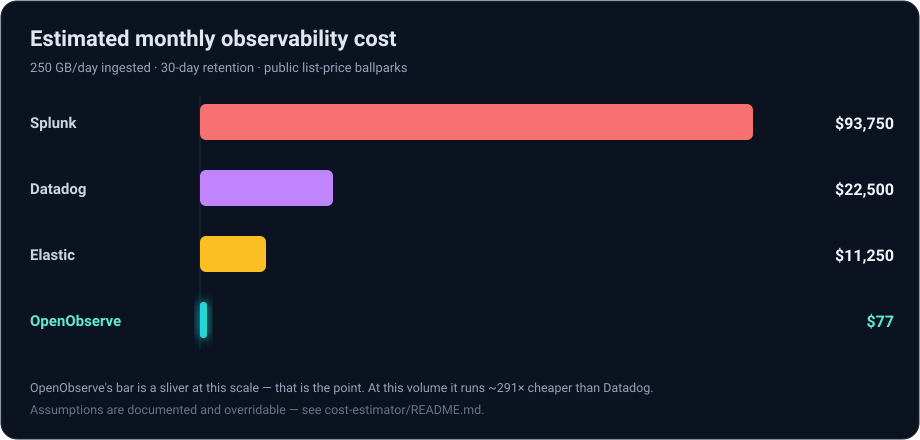
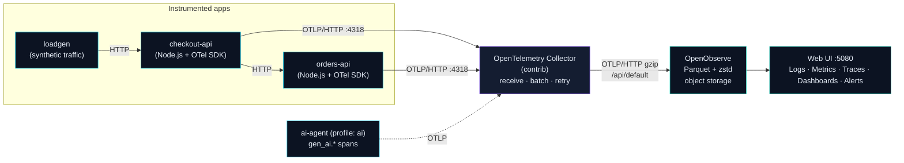

# OpenObserve Migration Accelerator

**A one-command local toolkit to POC and migrate observability from Datadog, Splunk or Elastic to [OpenObserve](https://openobserve.ai).**

Spin up a real OpenObserve, real OpenTelemetry ingestion, and real instrumented
microservices with a single `docker compose up` — then use the migration
recipes, dashboards, alerts, runbook and cost model to plan a production cutover.

[](./LICENSE)
[](https://openobserve-cost-calculator.vercel.app)
[](https://opentelemetry.io)
[](https://openobserve.ai)
[](./docker-compose.yml)
[](./CONTRIBUTING.md)

> 💰 **Try the cost calculator (no install):** **[openobserve-cost-calculator.vercel.app](https://openobserve-cost-calculator.vercel.app)**
> ← live web app · CLI lives in [`cost-estimator/`](./cost-estimator)

---

## The savings, at a glance



At **250 GB/day with 30-day retention**, the same telemetry costs roughly:

| Platform | Est. monthly | Est. annual | vs OpenObserve |
| --- | ---: | ---: | ---: |
| Splunk | $93,750 | $1,125,000 | ~1,214× |
| Datadog | $22,500 | $270,000 | ~291× |
| Elastic | $11,250 | $135,000 | ~146× |
| **OpenObserve** | **$77** | **$927** | — |

> These are public list-price ballparks for framing a POC, **not quotes**.
> The model is open, documented and overridable — plug in your real volume and
> negotiated rates with the [CLI](#the-cost-angle) or the [web calculator](https://openobserve-cost-calculator.vercel.app).

---

## Table of contents

- [The savings, at a glance](#the-savings-at-a-glance)
- [Why this exists](#why-this-exists)
- [Quickstart](#quickstart)
- [Architecture](#architecture)
- [What's inside](#whats-inside)
- [The cost angle](#the-cost-angle)
- [Migration assets](#migration-assets)
- [How this maps to a real POC](#how-this-maps-to-a-real-poc)
- [See it in action](#see-it-in-action)
- [Roadmap](#roadmap)
- [Contributing](#contributing)
- [License](#license)
- [Disclaimer](#disclaimer)

---

## Why this exists

Moving off a logging/APM vendor is a six-figure decision gated by a POC that
nobody has time to build. This repo collapses that POC into an afternoon:

- **Proof, not slides.** Real OTLP telemetry flowing into a real OpenObserve,
  with logs, metrics and traces correlated by `trace_id`.
- **The migration, pre-written.** Dual-write configs for the paths teams
  actually use (Datadog Agent, Fluent Bit, Vector, HEC, Kubernetes), plus
  dashboards, alerts and a phased runbook.
- **The number, modeled.** A CLI and web calculator that turn "GB/day + retention"
  into an OpenObserve bill and a savings figure you can defend.

**Who it's for:** platform engineers, SREs and observability leads evaluating
OpenObserve, and Customer Success/field engineers who need a credible POC in
front of a customer fast.

---

## Quickstart

```bash
git clone https://github.com/NullLabTests/openobserve-migration-accelerator.git
cd openobserve-migration-accelerator
cp .env.example .env          # local demo credentials (see below)
docker compose up -d          # ~1–2 min for images; data flows within seconds
```

Then open **http://localhost:5080** and log in with the **local demo**
credentials:

| Field | Value |
| --- | --- |
| URL | http://localhost:5080 |
| Email | `root@example.com` |
| Password | `Complexpass#123` |

> ⚠️ **These are throwaway local credentials. Never use them outside your
> laptop.** Change them in `.env` for anything shared.

Within a minute or two you'll see:

- **Logs** → stream `default` (from `checkout-api` and `orders-api`)
- **Traces** → streams `checkout-api` and `orders-api`, correlated with logs
- **Metrics** → `demo_requests_total`, `demo_request_duration`, plus HTTP metrics

Enable the **AI/LLM observability** demo (optional):

```bash
docker compose --profile ai up -d --build   # emits gen_ai.* spans to stream ai-agent-demo
```

Tear down (and wipe data):

```bash
docker compose down          # keep the data volume
docker compose down -v       # also delete the oo-migration-data volume
```

---

## Architecture



The collector is the single choke point: swap the demo services for your own
apps and the collector + backend stay identical. See
[`docs/architecture.md`](./docs/architecture.md) for the deep dive.

---

## What's inside

| Path | What it is |
| --- | --- |
| [`docker-compose.yml`](./docker-compose.yml) | The whole local stack: OpenObserve, OTel Collector, two demo services, loadgen, optional AI agent |
| [`config/otelcol-config.yaml`](./config/otelcol-config.yaml) | OTLP receiver → OpenObserve exporter, ready to lift into prod |
| [`demo-app/`](./demo-app/) | Instrumented two-service Node.js app (logs + metrics + traces) |
| [`migration/`](./migration/) | Dual-write recipes, dashboards, alerts, and [`MIGRATION-RUNBOOK.md`](./migration/MIGRATION-RUNBOOK.md) |
| [`cost-estimator/`](./cost-estimator/) | Python CLI: `oo-cost --daily-gb 250 --source datadog` |
| [`website/`](./website/) | Next.js interactive cost calculator (deployed to Vercel) |
| [`ai-observability/`](./ai-observability/) | Bonus: agent loop emitting `gen_ai.*` spans |
| [`docs/`](./docs/) | [architecture](./docs/architecture.md) · [POC checklist](./docs/poc-checklist.md) |

---

## The cost angle

Observability bills scale with **bytes stored and searched**. OpenObserve stores
compressed Parquet on cheap object storage instead of a hot search index, which
is where the savings come from:

```
stored_gb    = daily_gb × retention_days × compression_ratio   # ~10x compression
storage_cost = stored_gb × storage_price                       # ~$0.023/GB/mo
compute_cost = nodes × $60                                     # 1 modest node
openobserve  = storage_cost + compute_cost
```

**CLI** (mirrors the [web calculator](https://openobserve-cost-calculator.vercel.app)):

```bash
cd cost-estimator
python3 -m openobserve_cost --daily-gb 250 --retention-days 30 --source datadog
```

```
OpenObserve estimated cost
  Object storage / month      : $17.25
  Compute / month             : $60.00
  TOTAL / month               : $77.25
  TOTAL / year                : $927.00

Comparison
  Current source              : datadog
  Estimated savings / year    : $269,073.00
```

Every assumption (compression ratio, storage $/GB, provider rates) is a
documented, overridable knob — see
[`cost-estimator/README.md`](./cost-estimator/README.md). The Python and
TypeScript models are kept in lock-step by tests.

---

## Migration assets

[`migration/`](./migration/) is the part a Customer Success engineer hands over:

- **Dual-write recipes** — [Datadog Agent](./migration/datadog/),
  [Fluent Bit](./migration/fluent-bit/), [Vector](./migration/vector/),
  [Splunk HEC / direct JSON](./migration/hec/),
  [Kubernetes Helm](./migration/kubernetes/).
- **Dashboards** — [service overview, cost/volume, trace↔log correlation](./migration/dashboards/).
- **Alerts** — [high error rate, high latency, volume drop](./migration/alerts/).
- **Runbook** — the phased [MIGRATION-RUNBOOK.md](./migration/MIGRATION-RUNBOOK.md).

---

## How this maps to a real POC

| This repo | In a real engagement |
| --- | --- |
| `docker compose up` stack | OpenObserve + Collector in a staging namespace |
| `demo-app` services | Your pilot service (one high-volume, well-understood) |
| `otelcol-config.yaml` | The same collector config, pointed at production object storage |
| `migration/datadog` etc. | Dual-write from your existing agents |
| `migration/dashboards` + `alerts` | Parity checks against the incumbent |
| `MIGRATION-RUNBOOK.md` | The plan you run with the customer, phase by phase |
| `cost-estimator` | The business case, with your real volume and rates |

Follow [`docs/poc-checklist.md`](./docs/poc-checklist.md) to run it end to end.

---

## See it in action

After `docker compose up`, capture these to make the story tangible:

1. **Logs** (`http://localhost:5080` → Logs → `default`) — filter `level = 'error'`, expand a row to see `trace_id`.
2. **Traces** — open a trace from `checkout-api`; show the checkout→orders service map and the `orders.process` child span.
3. **Dashboards** — import [`migration/dashboards/service-overview.json`](./migration/dashboards/) and screenshot the request/error/latency panels.
4. **Cost calculator** — screenshot the website hero + result card.

> Drop real screenshots into `docs/images/` and reference them here.

---

## Roadmap

- [ ] Receiver recipes for Loki, Kafka, and CloudWatch Logs.
- [ ] Terraform module for the OpenObserve + Collector production deployment.
- [ ] Grafana-compatible dashboard export.
- [ ] Budget/alert templates tied to the cost model.
- [ ] More provider price books (New Relic, Grafana Cloud, Logz.io).

Have a use case? Open an issue or a PR — see [Contributing](#contributing).

---

## Contributing

PRs welcome — see [`CONTRIBUTING.md`](./CONTRIBUTING.md). Good first issues:
add a receiver recipe (Loki, Kafka), add a dashboard, or port the calculator to
more providers. Keep configs copy-pasteable and credentials out of the repo.

## License

[MIT](./LICENSE).

---

## Disclaimer

This is a community project. It is **not affiliated with, sponsored by, or
endorsed by** Zinclabs/OpenObserve, Datadog, Splunk or Elastic. Vendor names are
used descriptively. Default credentials are for **local, throwaway use only**.
Cost figures use public list-price ballparks and are estimates for planning, not
quotes.
