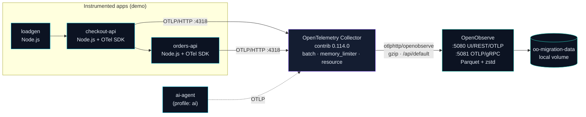

# Architecture

This document explains how the local POC stack fits together and, more
importantly, which parts are **throwaway demo** and which parts are **the thing
you actually migrate to production**.



## Components

### OpenObserve (`openobserve`)

The migration target. Single binary, exposes:

- **:5080** — Web UI, REST API, and OTLP/HTTP ingest (path `/api/<org>`)
- **:5081** — OTLP/gRPC ingest

It writes **Parquet compressed with zstd** to its `ZO_DATA_DIR`. In the POC that
is a Docker volume; in production it is object storage (S3/GCS/Azure) — *that
substitution is the entire cost story*. Local env: `ZO_ROOT_USER_EMAIL`,
`ZO_ROOT_USER_PASSWORD`, `ZO_DATA_DIR=/data`, `ZO_TELEMETRY=false`.

> The published image is **distroless** — no `sh`, `curl` or `wget` — so the
> compose healthcheck uses the binary's own probe, `openobserve node status`
> (an internal `GET /node/status` that exits non-zero on failure).

### OpenTelemetry Collector (`otel-collector`)

The **only** component that talks to the backend. Everything sends OTLP to the
collector; the collector fans out to OpenObserve. This is deliberate:

- Apps stay backend-agnostic (vendor-neutral OTLP).
- Retry/batch/backpressure live in one place.
- In production you only change the **exporter**, not every service.

Pipeline: `otlp` + `prometheus` receivers → `memory_limiter` → `resource` →
`batch` → `otlphttp/openobserve` (+ `debug`). Config:
[`config/otelcol-config.yaml`](../config/otelcol-config.yaml).

The OpenObserve exporter:

```yaml
exporters:
  otlphttp/openobserve:
    endpoint: http://openobserve:5080/api/default   # collector appends /v1/{traces,metrics,logs}
    headers:
      Authorization: "${env:OPENOBSERVE_AUTH}"       # Basic base64(user:password)
    compression: gzip
```

> No trailing slash on the endpoint. The OTLP exporter appends
> `/v1/traces`, `/v1/metrics`, `/v1/logs`.

### Demo services (`checkout-api`, `orders-api`)

A two-service Node.js app instrumented with the OpenTelemetry SDK:

- **Auto-instrumentation** for HTTP/Express.
- **Manual spans** on the business path (`orders.process`), so traces show
  service-to-service calls.
- **Structured logs** emitted via the OTel Logs API — including inside spans, so
  log lines carry `trace_id` for correlation. Interview-grade detail: logs and
  traces are not two separate silos here; they join on `trace_id`.

`checkout-api` calls `orders-api` over HTTP, so a checkout request produces a
distributed trace across both services.

### loadgen

Sends steady synthetic traffic (including a share of errors and slow requests)
so dashboards and alerts have something to show without you clicking around.

### ai-agent (optional, `--profile ai`)

Emits OTel `gen_ai.*` spans from a simulated agent loop. See
[`ai-observability/`](../ai-observability/).

## Data flow, concretely

1. `loadgen` → `POST /checkout` on `checkout-api`.
2. `checkout-api` starts a span, calls `orders-api`, which starts a child span
   and emits a log. The child span's `trace_id` propagates via headers.
3. Both services' SDKs batch and export OTLP/HTTP to `otel-collector:4318`.
4. The collector batches, adds resource attrs, and exports to
   `openobserve:5080/api/default` with gzip.
5. OpenObserve writes Parquet; the UI can query logs, metrics and traces and
   pivot between them on `trace_id`.

## What changes for production

| POC (this repo) | Production |
| --- | --- |
| Docker volume `oo-migration-data` | Object storage bucket (S3/GCS/Azure) |
| Single `openobserve` container | HA deployment (Kubernetes/Helm), 2+ nodes |
| Collector as a compose service | Collector as a DaemonSet/Deployment/agent |
| Default credentials | Real secrets (K8s Secret / vault), TLS |
| `debug` exporter on | `debug` exporter off |
| Loadgen | Your real workloads, dual-writing during cutover |

The **collector config and instrumentation** carry over unchanged — that is the
point of building the POC this way.

## Design decisions (and why)

- **Collector in front of OpenObserve**, not apps → OpenObserve directly: keeps
  apps portable and centralizes retry/backpressure. Matches how teams migrate
  without redeploying every app.
- **OTLP/HTTP (not gRPC) in the demo**: traverses corporate proxies more easily;
  the collector supports gRPC on `:4317` if you prefer.
- **Two services, not one**: distributed traces and cross-service correlation
  are the features teams care about, so the demo exercises them.
- **Static-export website**: the calculator is pure client-side math — no API,
  no server, trivial to host anywhere (Vercel/Pages/S3).
